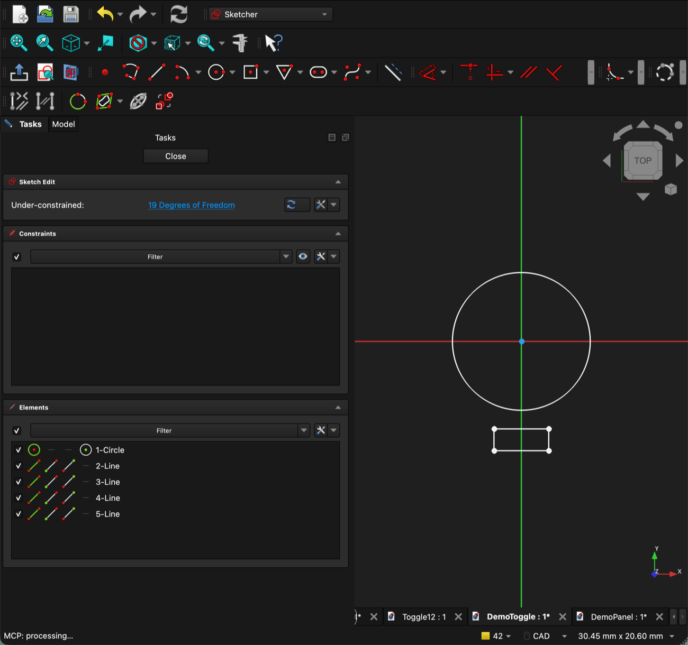
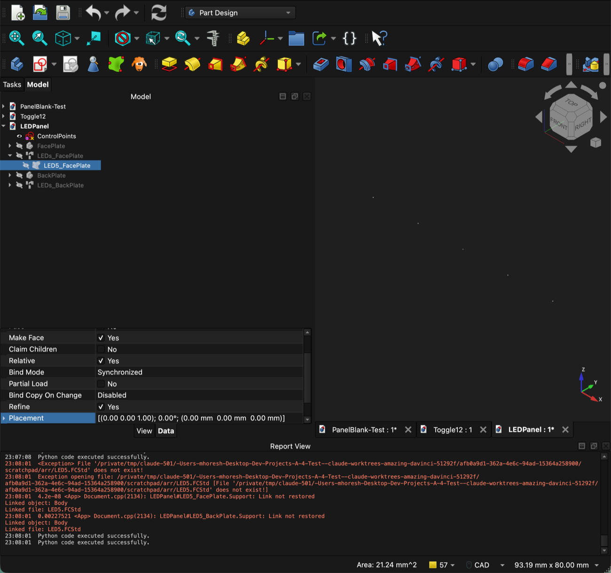
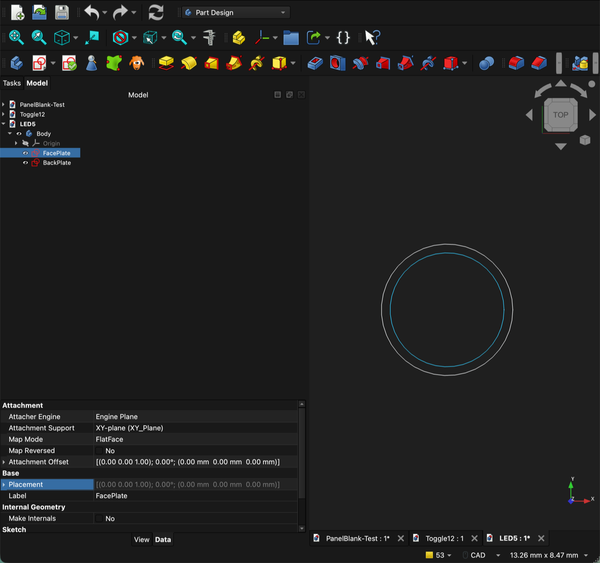
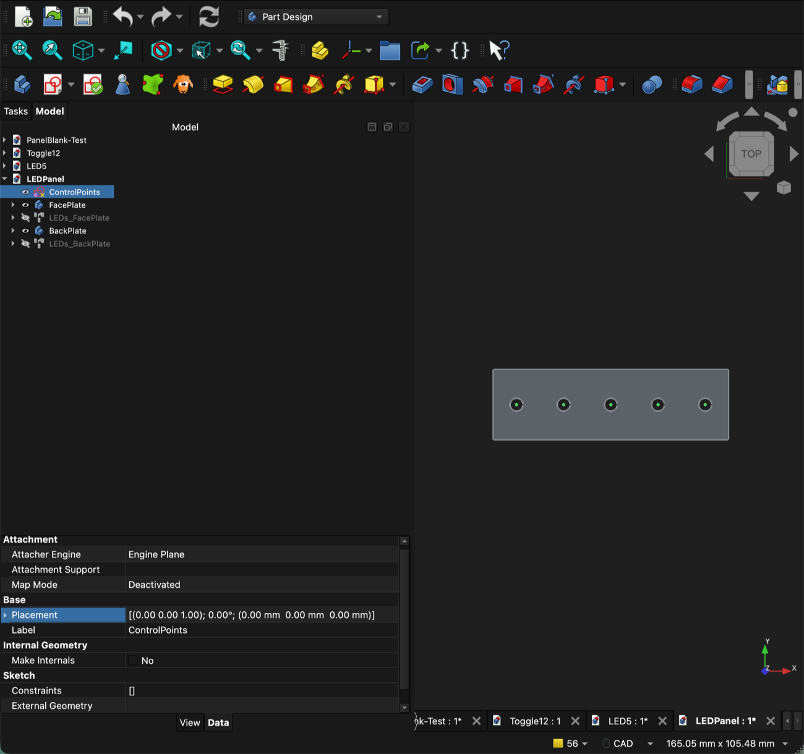
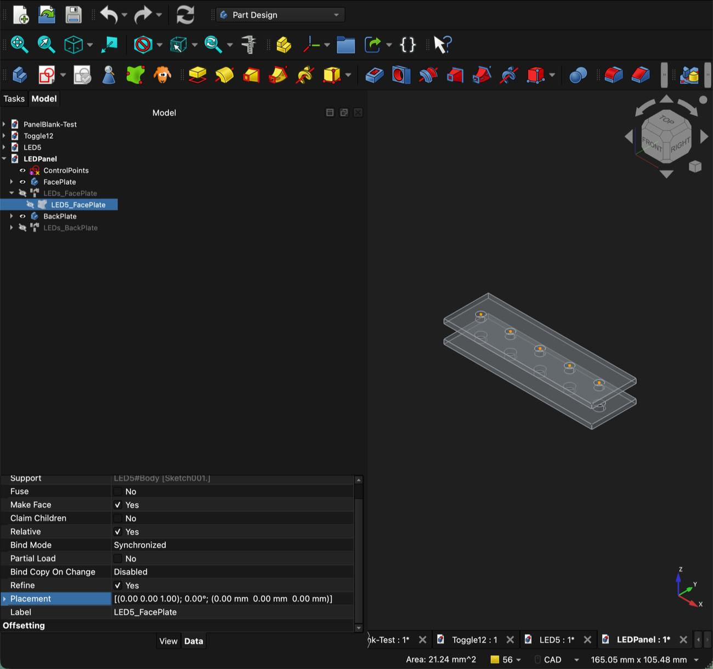
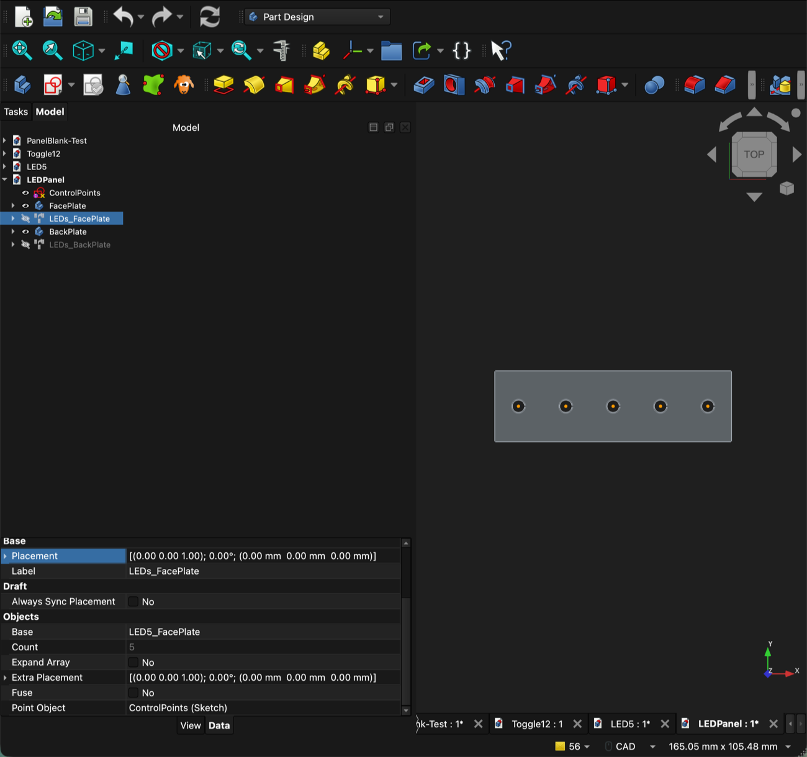
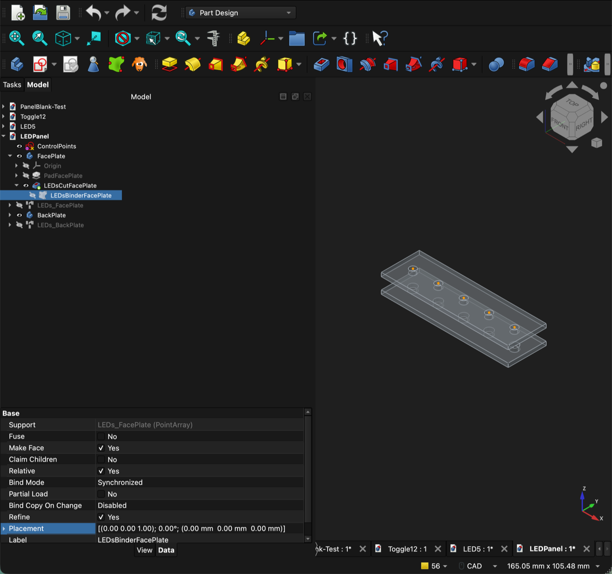
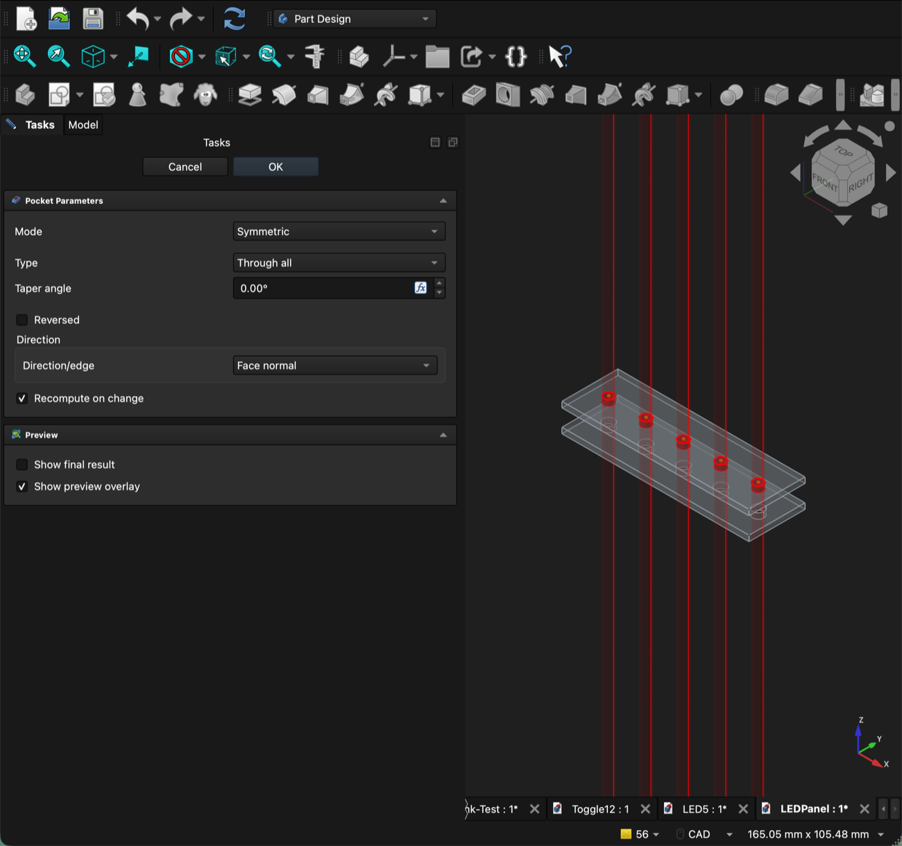
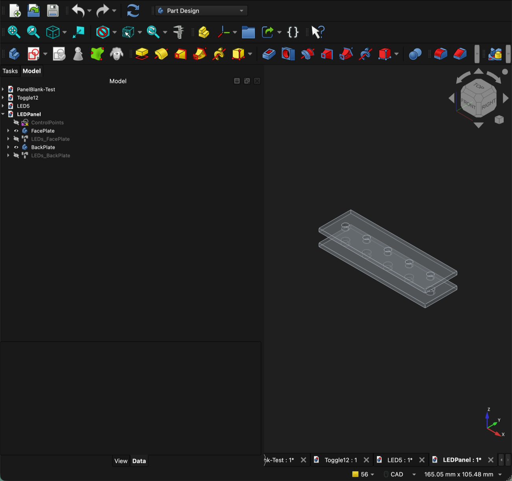

# CAD Cutout Library (FreeCAD)

> **Status:** spike for #335, verified in FreeCAD 1.1.1. CAD tooling (D8) is still open,
> so this is an internal reference page. Once D8 lands it gets promoted into
> `docs/hardware/cad-workflow.md`.

Draw each control's cutout **once**, in a small library file, and link it into every panel
that uses it. Edit the library and every panel picks up the change. Each control in a
panel can still be moved and rotated on its own. For rows of identical controls that never
rotate, such as LEDs, see [Array placement](#array-placement-for-identical-unrotated-controls).

The screenshots below come from a small demo built for this page: a Toggle12-style library
part and a 100 × 50 mm BackPlate with two controls, SW1 and SW2. SW2 is rotated 90°.

## How the pieces fit

```
CAD/Shared/Cutouts/Toggle12.FCStd          ← library part (one file per part)
└── Body
    ├── FacePlate   (sketch: Ø12.6 hole)
    └── BackPlate   (sketch: Ø12.6 hole + anti-rotation tab)

<panel>.FCStd                              ← the panel
├── Panel Blank (group)
│   └── ControlPoints   (sketch: one point per control)
├── Controls (group)
│   ├── SW1   (LCS on ControlPoints:Vertex1)
│   └── SW2   (LCS on ControlPoints:Vertex2, rotated 90°)
├── FrontPlate (Body)
│   └── … SW1_Face (binder → FacePlate) → Pocket, SW2_Face → Pocket
└── BackPlate (Body)
    └── … SW1_Back (binder → BackPlate) → Pocket, SW2_Back → Pocket
```

- **ControlPoints**: the *where*. One plain sketch point per control. Move a point and the
  control moves on every plate.
- **One LCS per control**: the *which way*. A Local Coordinate System is pinned to its
  point and carries that control's rotation. The LCS label is the KiCad reference (`SW1`).
- **One Sub-Shape Binder per control per plate layer**: a live, cross-file copy of the
  library sketch for that layer, placed by the control's LCS.
- **Pocket the binder directly** (Through all, Symmetric). You don't need an
  External-Geometry cut sketch.

The library holds one sketch per **layer**, because the plates need different holes. In
Toggle12, for example, the BackPlate layer carries the anti-rotation tab and the FacePlate
layer doesn't.

## Library conventions

| Rule | Why |
|---|---|
| One file per part, one Body, one sketch per plate layer | Binders link to a sketch by name, so each layer must be its own sketch |
| Label sketches by layer: `FacePlate`, `BackPlate` | Tells you which binder points where |
| Centre the cutout on the sketch origin (0,0) | The LCS places the origin, so (0,0) is the control's centre |
| Edit sketches in place: never delete and recreate them | The binder links to the sketch's internal name. A recreated sketch breaks every panel |
| Save the library in its final folder **before** linking it | Links store a relative path. Moving the file later breaks them |

## Panel conventions

| Rule | Why |
|---|---|
| ControlPoints uses ordinary (non-construction) points | The LCS attaches to `Sketch:VertexN` |
| Never delete and re-add points in ControlPoints. Move them instead | The LCS binds by vertex **index**, so deleting a point renumbers the rest |
| LCS label = KiCad reference (`SW1`, `S3`, …) | Ties CAD to schematic and firmware |
| Keep the LCSs in a `Controls` group | Keeps the tree tidy when there are dozens |
| Save the panel in its final folder **before** creating binders | Same relative-path reason as the library |

## Recipe

### 1. Library part

1. New file, saved in `CAD/Shared/Cutouts/` (e.g. `Toggle12.FCStd`).
2. Part Design → Create body, then one sketch per layer on the XY plane.
3. Draw each layer's cutout, centred on the origin. Rename the sketches `FacePlate` and
   `BackPlate`.
4. Save.



### 2. Control positions

1. In the panel, open the `ControlPoints` sketch (Sketcher workbench).
2. Add one **Point** per control and dimension it from the origin.
3. Close the sketch.


### 3. One LCS per control

1. Select nothing. Then Part (or Part Design) → **Create datum → Coordinate system**.
2. In the attachment panel, **type** the reference into the field: `Sketch:Vertex1`
   (use `ControlPoints`' internal name, shown in the tooltip; it's usually `Sketch`).
3. Attachment mode: **Translate origin**. OK.
4. Rename it to the KiCad reference (`SW1`) and drag it into the `Controls` group.
5. **To rotate the control:** edit SW1 again (double-click it) and set **Around Z-axis**
   under *Attachment Offset*.


### 4. Bind and cut (per control, per plate)

1. Make the **panel** the active document. Double-click the plate Body (e.g. FrontPlate)
   so it's active, and select **nothing**.
2. Part Design → **Create a sub-object(s) shape binder**. An empty binder appears inside the
   body.
3. In the tree, **drag** the library's layer sketch (`FacePlate` or `BackPlate`) onto
   the new binder. Both documents appear in the same tree.

   

4. Select the binder → Property view → right-click **Placement** → **Expression…** and
   enter:

   ```
   placement(SW1.Placement.Base; SW1.AttachmentOffset.Rotation)
   ```

   Use the LCS's internal **Name**, which may be `LCS` or `LCS001` and not the `SW1`
   label. When it works, *Support* shows the library sketch and *Placement* turns blue,
   which means it's driven by the expression.

   
5. With the binder selected, run **Pocket**: set Mode to **Symmetric** and Type to
   **Through all**. OK.

   
6. Rename the binder `SW1_Face` (or `SW1_Back` on the BackPlate).
7. Save. When you're asked "Save dependent files?", answer **No** unless you edited the
   library on purpose.

Repeat for the other plate layer. In the result below, SW2 is rotated 90°: its tab sits to
the side, while SW1's points down.


## Gotchas

- **Translate origin ignores the offset rotation.** This is the big one. The LCS applies
  the Attachment Offset *translation* but drops its *rotation*. Vertex-only references
  support no other attachment mode. So the binder expression takes the position from the
  LCS and the rotation from the offset:
  `placement(SWn.Placement.Base; SWn.AttachmentOffset.Rotation)`. Plain `SWn.Placement`
  never rotates.
- **The binder has no Attachment.** A Sub-Shape Binder can't be attached in 1.1.1, so the
  Placement expression is how it gets positioned.
- **The binder lands in the wrong file or at the document root.** That happens when the
  library document was active or no body was active. Delete it and redo step 4.1 with the
  panel active and the body double-clicked. If it appears at the root, drag it into the
  body.
- **You can't pick a sketch point.** Points are drawn tiny and the plates cover Z=0.
  Raise *Preferences → Display → 3D View → Pick radius* to about 10 px, or just type
  `Sketch:VertexN` into the attachment field.
- **Clicks become references.** While the attachment panel shows "Selecting…", every
  click in the tree or the 3D view is added as a reference. A bad click leaves the LCS
  invalid (red `!`). Re-open it and re-type the reference.
- **Don't move the body, stack plates with the Pad.** The binder compensates for its
  container's placement, so moving the Body leaves the cutouts behind. Set the plate's
  Z position on the Pad (Reversed) and leave the Body placement alone.
- **`=` doesn't open the expression editor.** It only works while a value is being edited.
  Use right-click → **Expression…**.
- **"Save dependent files?"** means the linked library has unsaved edits. Answer **No**
  unless you changed the library deliberately.
- **No live rotation preview.** The cutout updates when you recompute (Ctrl+R) after you
  change the angle.
- **The library doesn't need to be open.** Opening the panel loads the linked library
  automatically.
- **Library edits show up on recompute.** After you edit and save a library sketch, the
  panel's binders are marked as changed the next time the panel opens. Press Ctrl+R to
  update the cutouts.
- **A renamed or moved library fails quietly.** The panel still opens and the cutouts keep
  their last shape. The tree shows no error. The only sign is a red `Link not restored`
  line in the **Report view**. Put the file back under its old name and the link returns,
  even if you saved the panel while the link was broken. Check the Report view after any
  rename or move in `CAD/Shared/Cutouts/`.

  

## Array placement for identical, unrotated controls

One LCS per control gives each control its own rotation, but it costs an LCS, a binder and
a pocket per control per layer. For a row or grid of identical controls that never rotate,
such as indicator LEDs, a **Draft Point Array** over a points sketch places every copy
at once. Each layer needs one array and one pocket, however many controls there are.

The screenshots come from a second demo: an `LED5` library part (FacePlate Ø5.2, BackPlate
Ø6.0) and a 100 × 30 mm panel with a row of five LEDs.

### When to use which

| | LCS per control | Point array |
|---|---|---|
| Rotation | Each control has its own | All copies share one orientation |
| Objects for N controls, 2 layers | N LCS + 2N binders + 2N pockets | 2 arrays + 4 binders + 2 pockets, whatever N is |
| Add a control | Add a point, an LCS, then a binder and pocket per layer | Add a point |
| Remove a control | Delete its objects, but **keep** its point (LCSs bind by index) | Delete the point |
| KiCad reference in the tree | Yes (the LCS label) | No, the points are anonymous |
| Parts per placement | Any part | One library part per array |
| Workbenches | Part Design | Part Design + Draft |

Use an **array** for banks of identical, unrotated controls such as LED rows, annunciator
lamps and push-button banks. Use **LCS per control** when a control rotates, or when you
want its KiCad reference visible in the tree. One panel can use both.

### How the pieces fit

```
CAD/Shared/Cutouts/LED5.FCStd              ← library part
└── Body
    ├── FacePlate   (sketch: Ø5.2 hole)
    └── BackPlate   (sketch: Ø6.0 hole)

<panel>.FCStd
├── LED_Points            (sketch: one point per LED, nothing else)
├── LEDs_FacePlate        (Draft PointArray over LED_Points)
│   └── LED5_FacePlate    (root binder → LED5 FacePlate sketch)
├── LEDs_BackPlate        (Draft PointArray over LED_Points)
│   └── LED5_BackPlate    (root binder → LED5 BackPlate sketch)
├── FacePlate (Body)
│   └── … LEDsCutFacePlate (Pocket) ← LEDsBinderFacePlate (binder → LEDs_FacePlate)
└── BackPlate (Body)
    └── … LEDsCutBackPlate (Pocket) ← LEDsBinderBackPlate (binder → LEDs_BackPlate)
```

The array copies the binder once per point in the points sketch. A second binder carries
the arrayed shape into the plate body, where it's pocketed. You don't need a Placement
expression, because the array already puts every copy in place.

### Recipe

#### 1. Library part

Same as [step 1](#1-library-part) above. Draw one sketch per layer, centred on the
origin, and save the file in `CAD/Shared/Cutouts/`.



#### 2. Points sketch

1. In the panel, create a sketch (here `LED_Points`) with one **Point** per LED.
2. Put **only** this array's points in it. The array places a copy on every vertex in the
   sketch, so a shared ControlPoints sketch would also put LEDs on your toggles.



#### 3. Root binder (one per layer)

1. Make the panel the active document, with **no** body active, and select nothing.
2. Part Design → **Create a sub-object(s) shape binder**. With no active body, the binder
   lands at the document root.
3. Drag the library's layer sketch (`FacePlate`) onto it, the same way as in step 4.3
   above. Leave its Placement alone.



#### 4. Point array (one per layer)

1. Switch to the Draft workbench. Select the root binder, then Ctrl-click `LED_Points`.
2. Modification → Array tools → **Point array**.
3. Check the array's properties: *Base* is the binder, *Point Object* is `LED_Points`, and
   *Count* matches the number of points. Rename the array (`LEDs_FacePlate`).



#### 5. Bind and cut

1. Back in Part Design, double-click the plate Body so it's active, then select nothing.
2. Create a sub-shape binder, then drag the **array** (`LEDs_FacePlate`) onto it.
3. With the binder selected, run **Pocket**: Mode **Symmetric**, Type **Through all**.





Repeat steps 3–5 for the BackPlate layer, with a second root binder on the library's
`BackPlate` sketch and a second array over the same `LED_Points`.



### Array gotchas

- **One points sketch per array.** Every vertex becomes a copy, and that includes the
  endpoints of any normal line. Construction geometry is ignored. Keep each array's points
  in a sketch of its own.
- **All copies share one orientation.** The array's *Extra Placement* rotates every copy
  the same way. A control that needs its own angle belongs in the LCS recipe.
- **Deleting a point is safe here.** The array has no per-index links, so adding, moving
  or deleting points just changes the copies. This is the opposite of the LCS rule.

## Verification (#335)

| Check | Result |
|---|---|
| LCS: move a ControlPoints point → both layers follow | ✅ |
| LCS: rotate an LCS → both layers rotate | ✅ |
| Pocket a cross-file binder directly | ✅ |
| Opening the panel alone auto-loads the library | ✅ |
| Edit a library sketch → panel cutouts update | ✅ after a recompute (Ctrl+R) |
| Rename or move the library → link breaks visibly | ⚠️ Only in the Report view. The tree shows no error and the cutouts keep their last shape (see Gotchas) |
| Array: move, add or delete a point → both layers update | ✅ |
| Array: edit the library sketch → every copy on both layers updates | ✅ |

## Related

- #334: the blank-panel generator should also emit `ControlPoints` and one LCS per
  control, and wire the binders with the rotation-aware expression above.
- [Mechanical standards](../hardware/mechanical-standards.md): Dzus grid and mounting
  holes for the panel blank.
- The spike files, `CAD/Shared/Cutouts/Toggle12.FCStd` and
  `CAD/Shared/Cutouts/_spike/PanelBlank-Test.FCStd`, land with the #335 CAD branch.
