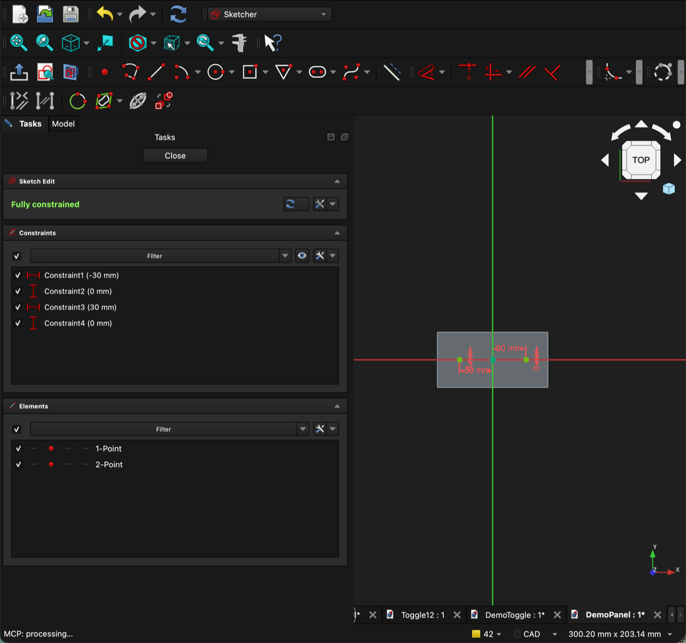
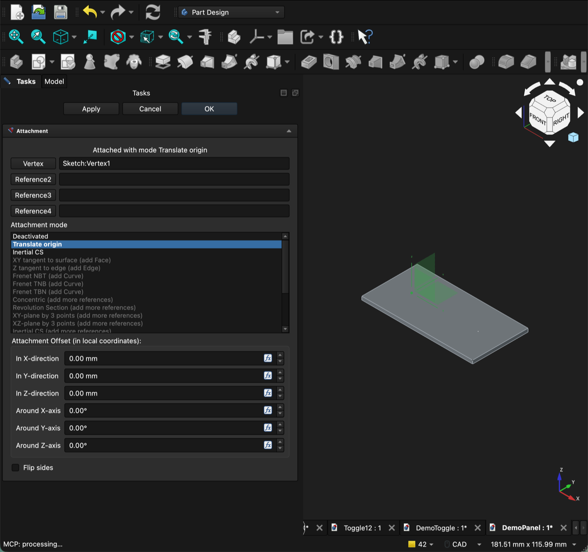
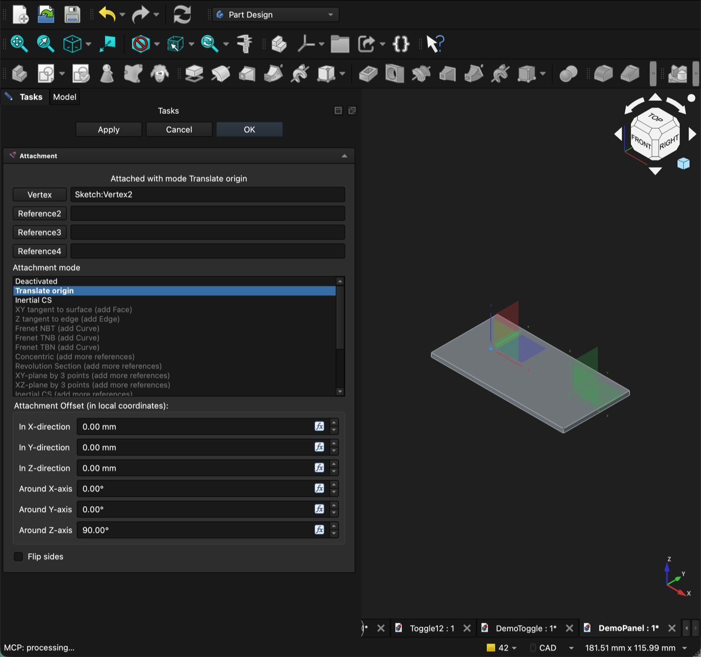
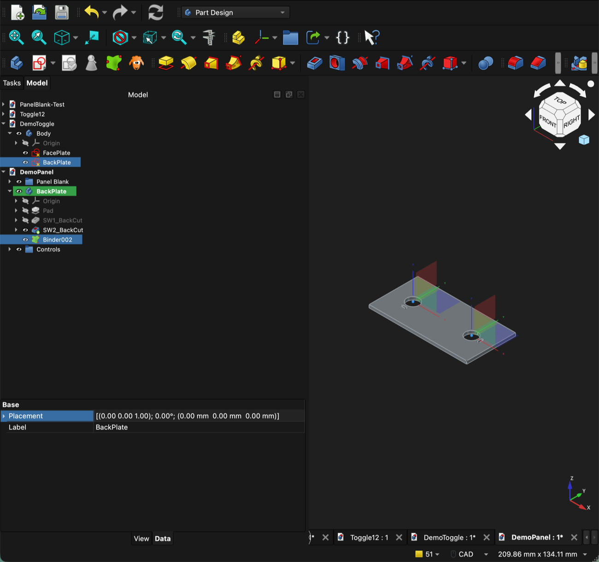
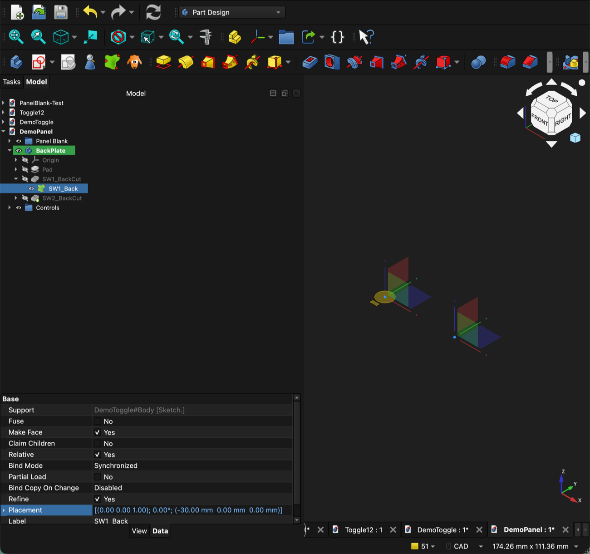
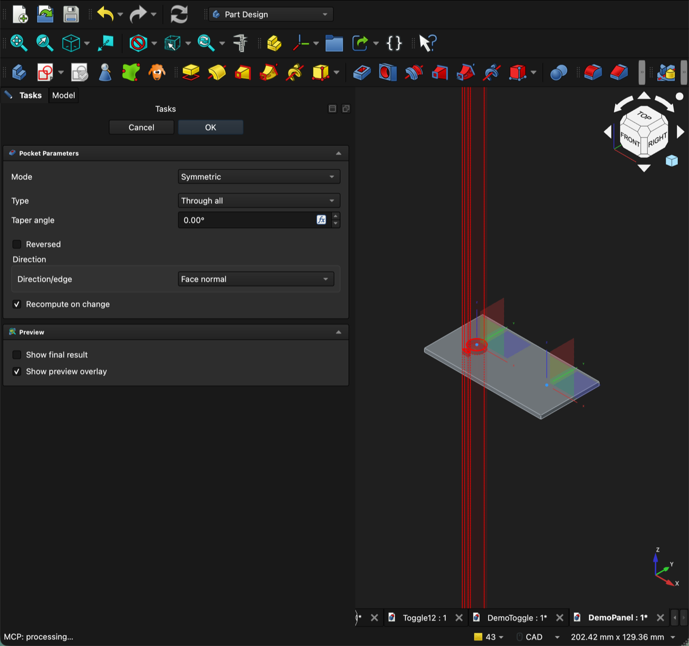
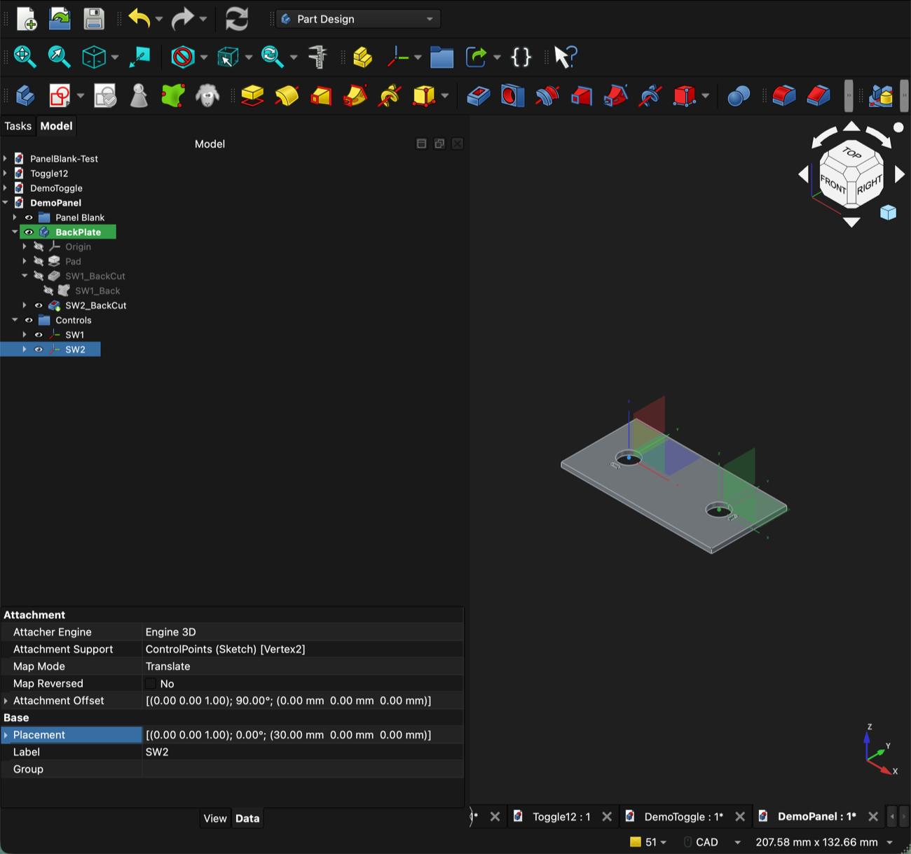

# Method A: LCS per control

Each control gets its own Local Coordinate System (LCS), pinned to a point and carrying
that control's rotation. Use this method when a control rotates, or when you want its
KiCad reference visible in the tree. For rows of identical, unrotated controls, the
[point array](array-placement.md) is lighter. Back to the [overview](index.md).

Build the [library part](library-part.md) first.

The screenshots come from a small demo: a Toggle12-style library part and a 100 × 50 mm
BackPlate with two controls, SW1 and SW2. SW2 is rotated 90°.

## How the pieces fit

```
CAD/Shared/Cutouts/Toggle12.FCStd          ← library part
└── Body
    ├── FacePlate   (sketch: Ø12.6 hole)
    └── BackPlate   (sketch: Ø12.6 hole + anti-rotation tab)

<panel>.FCStd
├── Panel Blank (group)
│   └── ControlPoints   (sketch: one point per control)
├── Controls (group)
│   ├── SW1   (LCS on ControlPoints:Vertex1)
│   └── SW2   (LCS on ControlPoints:Vertex2, rotated 90°)
├── FrontPlate (Body)
│   └── … SW1_Face (binder → FacePlate) → Pocket, SW2_Face → Pocket
└── BackPlate (Body)
    └── … SW1_Back (binder → BackPlate) → Pocket, SW2_Back → Pocket
```

- **ControlPoints**: the *where*. One plain sketch point per control. Move a point and the
  control moves on every plate.
- **One LCS per control**: the *which way*. The LCS is pinned to its point and carries the
  control's rotation. Its label is the KiCad reference (`SW1`).
- **One binder per control per plate layer**: a live, cross-file copy of the library
  sketch for that layer, placed by the control's LCS.
- **Pocket the binder directly** (Through all, Symmetric).

## Panel conventions

| Rule | Why |
|---|---|
| ControlPoints uses ordinary (non-construction) points | The LCS attaches to `Sketch:VertexN` |
| Never delete and re-add points in ControlPoints. Move them instead | The LCS binds by vertex **index**, so deleting a point renumbers the rest |
| LCS label = KiCad reference (`SW1`, `S3`, …) | Ties CAD to schematic and firmware |
| Keep the LCSs in a `Controls` group | Keeps the tree tidy when there are dozens |
| Save the panel in its final folder **before** creating binders | Links store a relative path |

## Recipe

### A1. Control positions

1. In the panel, open the `ControlPoints` sketch (Sketcher workbench).
2. Add one **Point** per control and dimension it from the origin.
3. Close the sketch.



### A2. One LCS per control

1. Select nothing. Then Part (or Part Design) → **Create datum → Coordinate system**.
2. In the attachment panel, **type** the reference into the field: `Sketch:Vertex1`
   (use `ControlPoints`' internal name, shown in the tooltip; it's usually `Sketch`).
3. Attachment mode: **Translate origin**. OK.
4. Rename it to the KiCad reference (`SW1`) and drag it into the `Controls` group.
5. **To rotate the control:** edit SW1 again (double-click it) and set **Around Z-axis**
   under *Attachment Offset*.





### A3. Bind and cut (per control, per plate)

1. Make the **panel** the active document. Double-click the plate Body (e.g. FrontPlate)
   so it's active, and select **nothing**.
2. Part Design → **Create a sub-object(s) shape binder**. An empty binder appears inside the
   body.
3. In the tree, **drag** the library's layer sketch (`FacePlate` or `BackPlate`) onto
   the new binder. Both documents appear in the same tree.

   

4. Select the binder → Property view → right-click **Placement** → **Expression…** and
   enter:

   ```
   placement(SW1.Placement.Base; SW1.AttachmentOffset.Rotation)
   ```

   Use the LCS's internal **Name**, which may be `LCS` or `LCS001` and not the `SW1`
   label. When it works, *Support* shows the library sketch and *Placement* turns blue,
   which means it's driven by the expression.

   
5. With the binder selected, run **Pocket**: set Mode to **Symmetric** and Type to
   **Through all**. OK.

   
6. Rename the binder `SW1_Face` (or `SW1_Back` on the BackPlate).
7. Save. When you're asked "Save dependent files?", answer **No** unless you edited the
   library on purpose.

Repeat for every control and every plate layer. In the result below, SW2 is rotated 90°:
its tab sits to the side, while SW1's points down.



## Gotchas

- **Translate origin ignores the offset rotation.** This is the big one. The LCS applies
  the Attachment Offset *translation* but drops its *rotation*. Vertex-only references
  support no other attachment mode. So the binder expression takes the position from the
  LCS and the rotation from the offset:
  `placement(SWn.Placement.Base; SWn.AttachmentOffset.Rotation)`. Plain `SWn.Placement`
  never rotates.
- **The binder has no Attachment.** A Sub-Shape Binder can't be attached in 1.1.1, so the
  Placement expression is how it gets positioned.
- **The binder lands in the wrong file or at the document root.** That happens when the
  library document was active or no body was active. In this method the binder belongs
  inside the plate Body. Delete it and redo step A3.1 with the panel active and the body
  double-clicked, or drag it into the body.
- **You can't pick a sketch point.** Points are drawn tiny and the plates cover Z=0.
  Raise *Preferences → Display → 3D View → Pick radius* to about 10 px, or just type
  `Sketch:VertexN` into the attachment field.
- **Clicks become references.** While the attachment panel shows "Selecting…", every
  click in the tree or the 3D view is added as a reference. A bad click leaves the LCS
  invalid (red `!`). Re-open it and re-type the reference.
- **`=` doesn't open the expression editor.** It only works while a value is being edited.
  Use right-click → **Expression…**.
- **No live rotation preview.** The cutout updates when you recompute (Ctrl+R) after you
  change the angle.
