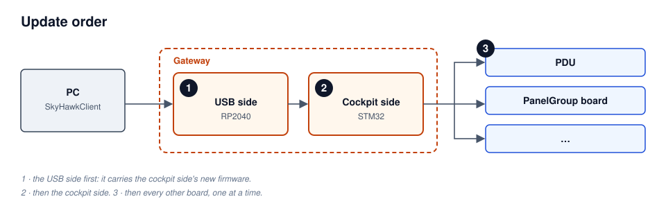

# First Setup & Updates

Every board gets its firmware by hand once: an ST-Link for the STM32 chips, a drag and drop for the
Gateway's RP2040. That first flash also puts the [bootloader](../firmware/bootloader.md) on each
STM32 board, so from then on the Gateway can be updated from SkyHawkClient with the cockpit wired
up as it is. This page walks through both, in order.

## What's in a release

A firmware release is one zip, `openskyhawk-firmware-<version>.zip`, with a folder per board. For
the first setup, each board needs one file from it:

| Board | File | How |
|---|---|---|
| Gateway, cockpit side (STM32) | `gateway/gateway-bridge-<version>-full.hex` | ST-Link |
| Gateway, USB side (RP2040) | `gateway/gateway-<version>.uf2` | drag onto the `RPI-RP2` drive |
| PDU Left / Right / Center | `pdu-left/pdu-left-<version>-full.hex` (and the same for `right`, `center`) | ST-Link |
| PanelGroup board | none: your own sketch, built with `pio run -t bootstrap` | ST-Link |

A `-full.hex` file holds the bootloader and the firmware together, which is what a new board needs.
The release has no PanelGroup file, because every panel group has its own node number and its own
controls: you build its firmware from your sketch, starting from
`Firmware/Examples/PanelGroupSample/` if you like.

## Flash every board once

**The Gateway's cockpit side.** Connect an ST-Link to the Gateway's SWD header and flash
`gateway-bridge-<version>-full.hex`; STM32CubeProgrammer opens it with the flash address already
in it. [Flashing Firmware](flashing.md) has the ST-Link steps and the fixes for a probe that won't
connect.

**The Gateway's USB side.** Close SkyHawkClient, then plug the Gateway into the PC. A new RP2040
shows up as a drive named `RPI-RP2` by itself; drag `gateway-<version>.uf2` onto it, and the drive
disappears as the Gateway restarts. Hold the BOOTSEL button while plugging in only if the drive
never appears.

**Each PDU.** Flash its `-full.hex` with the ST-Link, the same way as the Gateway's cockpit side.
Each PDU's file already carries its node number.

**Each PanelGroup board.** Connect the ST-Link and run `pio run -t bootstrap` in the board's sketch
project. That builds the bootloader and your firmware and flashes both in one go, as described in
[Flashing Firmware](flashing.md).

## Check the Gateway in SkyHawkClient

Power the cockpit, connect the Gateway to the PC and open SkyHawkClient. On the **Cockpit** tab,
the **Firmware** button opens a list of the boards with their firmware versions against the latest
release, starting with the Gateway's USB side and its cockpit side. If the cockpit side shows
**Manual update only**, it has no bootloader yet: flash its `-full.hex` as above.

## Update the Gateway

The Gateway goes first, and its USB side before its cockpit side: the USB side's firmware carries
the cockpit side's, so updating it brings the new cockpit-side firmware along. In the Firmware list,
click **Update** on the Gateway's USB side, then on its cockpit side. If you start with the cockpit
side while the USB side is behind, the client takes you to the USB side's update first.

The update dialog checks a few things before it starts, such as that the DCS relay is stopped, and
offers a button for each. Keep the PC awake and the cable in until the update finishes. If the USB
side is unplugged partway, plug it back in and check the Firmware list: if a board is still on its
old version or waiting in its bootloader, update it again.

## The other boards

Update the Gateway first, then the other boards with the ST-Link. A PDU takes the `.elf` from its
release folder, and a PanelGroup board takes `pio run -t upload` from its sketch project; both keep
the bootloader. [Flashing Firmware](flashing.md) has the steps.

To move a board to another node number, flash it by ST-Link with firmware for that node: the board
takes its node number from the firmware.

## Red and green together

A board whose red and green LEDs light together is in its bootloader, not running its firmware.
SkyHawkClient names the two cases that need you:

- **Needs firmware** — the last update didn't finish. Update the board again.
- **Won't start** — its firmware kept restarting, so the board stopped running it. Install a
  different version.

If an update can't reach a board because its firmware has stopped answering, click **Retry**, then
press the reset button on the board being updated. After a power cut during an update, follow
[Recovering from a power cut during an update](bring-up.md#recovering-from-a-power-cut-during-an-update).
The full list of LED patterns is on the [status LED](../firmware/debugging.md#in-the-bootloader-red-and-green-together)
page.
